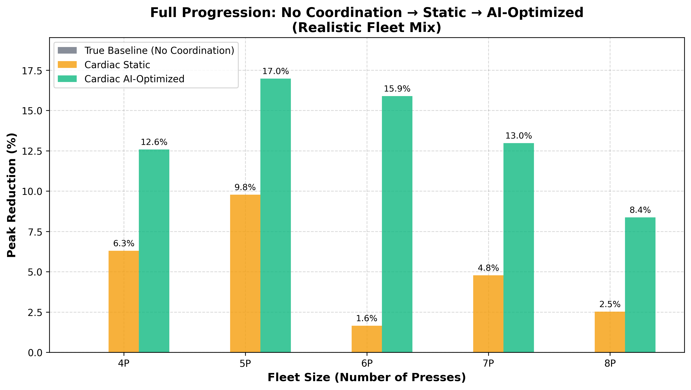
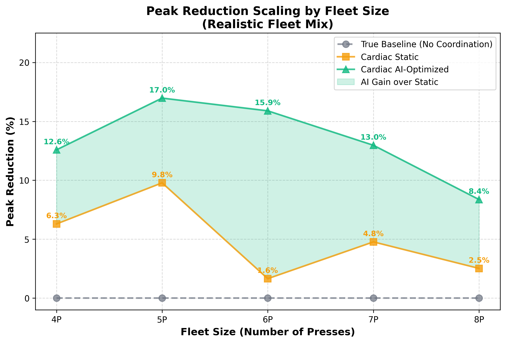
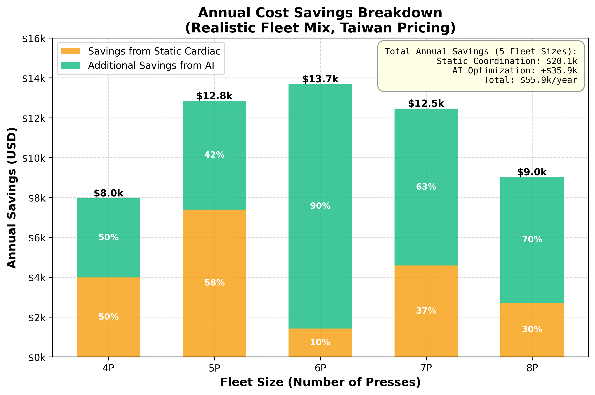

# Key Figures

## Figure 1: Full Progression Comparison

Compares peak reduction performance across three approaches: uncoordinated baseline (0%), static CARDIAC parameters (1.6-9.8%), and AI-optimized CARDIAC (8.4-17%). Demonstrates that AI optimization consistently outperforms hand-tuned static parameters across all fleet sizes (4-8 presses).  (Realistic Fleet Mix)

## Figure 2: Scaling by Fleet Size

Shows how peak reduction scales with fleet size for realistic press configurations. The shaded area represents additional performance gained from AI optimization over static parameters. Peak performance occurs at 5 presses (17.0%), with diminishing but still significant returns for larger fleets. (Realistic Fleet Mix)

## Figure 3: Annual Cost Savings Breakdown

Breaks down annual energy cost savings (Taiwan pricing) into two components: baseline savings from static CARDIAC coordination (orange) and additional savings from AI parameter optimization (teal). Total savings range from $8,000-$13,700 per year depending on fleet size, with AI contributing 50-90% of total benefit. (Realistic Fleet Mix)